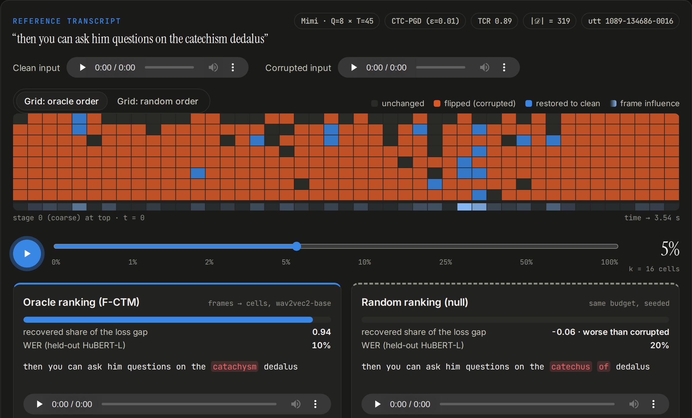

<div align="center">

# Not All Token Flips Matter

### Measuring Functional Fragility of Neural Speech Tokenizers

**Mohammad Khalooei**<sup>1</sup> · **Mohammad Sabokrou**<sup>2,3</sup>

<sup>1</sup>Sharif University of Technology · <sup>2</sup>New Uzbekistan University · <sup>3</sup>Okinawa Institute of Science and Technology

*Under review* · Contact: [mohammad.khalooei@sharif.edu](mailto:mohammad.khalooei@sharif.edu)

[](https://khalooei.github.io/CTM-Speech/)
[](results/)
[](LICENSE)

</div>

<p align="center"><a href="https://khalooei.github.io/CTM-Speech/"></a></p>

> **Most tokens flip. Few matter.** Small perturbations change 47–99% of the discrete tokens of
> neural speech tokenizers, yet on utterances whose transcript is damaged, restoring the oracle-ranked
> **5%** of changed cells recovers a median **64–70%** of the ASR loss gap, and the first RVQ stage alone
> recovers half or more.

**▶ [Listen to the interactive demo](https://khalooei.github.io/CTM-Speech/)**: drag a budget slider and hear speech heal as critical tokens are restored, side by side with random restoration.

---

## Overview

Token change rate (TCR) and unit edit distance count *how many* tokens a perturbation flips. We ask *which*
changed tokens carry the downstream failure. **Functional critical token mass (F-CTM)** is an oracle
counterfactual protocol: restore a subset *S* of the changed set 𝒟 to its clean values, decode, and measure
the recovered share of a downstream loss gap,

$$\mathrm{Rec}(S)=\frac{\mathcal L_{\text{corr}}-\mathcal L\big(g(Z'(S))\big)}{\mathcal L_{\text{corr}}-\mathcal L_{\text{clean}}},\qquad \mathrm{Rec}(\emptyset)=0,\quad \mathrm{Rec}(\mathcal D)=1 .$$

F-CTM<sub>α</sub> is the smallest prefix fraction of a ranking of 𝒟 whose restoration recovers a share α. Two
design choices make it measurable:

1. **The changed set is never subsampled.** Every ranking is a permutation of all of 𝒟 (frames first, then
   cells inside the 16 most influential frames), so full restoration recovers the gap by construction.
2. **Ranking and scoring are decoupled.** Cells are ranked with wav2vec2-base (also the PGD surrogate) and
   curves are scored by two held-out recognizers (HuBERT-large, wav2vec2-large-lv60). This removes the
   winner's-curse inflation of in-sample attribution, whose dependence on noise and gap we derive and test.

## Key results

Mean held-out AURC (area under the recovery curve) on identical gated rows of the main grid
(LibriSpeech test-clean, 120 utterances × 16 corruptions; Table 2 of the paper):

| Ranking | needs a decode? | DAC | Mimi | SpeechTokenizer |
|---|:-:|:-:|:-:|:-:|
| Random (permutation null) | no | 0.70 | 0.48 | 0.70 |
| VQ margin | no | 0.70 | 0.38 | 0.39 |
| Perturbation energy | no | 0.79 | 0.67 | 0.78 |
| RVQ-early (stage, then time) | no | **0.83** | 0.68 | 0.87 |
| Codeword displacement | no | 0.76 | **0.72** | **0.89** |
| Oracle, frame → cell (F-CTM) | yes | 0.85 | 0.80 | 0.86 |

* **Instability ≠ fragility.** Damage rate ranges from 6% (brown noise) to 66% (CTC-PGD) while TCR saturates; neither TCR nor ΔWER predicts concentration once corruption family and codec are fixed.
* **Structure.** Coarse RVQ stages carry the function; later stages restored alone are often harmful; cell-level refinement adds only ≈ +0.004 AURC over frame-level restoration.
* **Adversarial vs. natural.** After same-utterance severity matching, CTC-PGD damage is modestly more concentrated than Gaussian noise on DAC and Mimi, not on SpeechTokenizer, with no difference in F-CTM<sub>90</sub>.
* **Generalization**: LibriSpeech test-other, FLEURS, MUSAN/DEMAND noise, EnCodec, Qwen3-TTS tokenizer, WavTokenizer and StableToken.

## Repository layout

```
src/ctm/                 the protocol
  hier.py                changed set, hybrid oracle, frame→cell ranking, recovery curves, AURC / F-CTM
  runner_v2.py           resumable, shardable experiment runner (one JSONL row per utterance×codec×condition)
  analysis_v2.py         per-row metrics, scorer-resolution gate, bootstrap / paired tests, matching
  corruptions.py         Gaussian / colored / bit-crush / ESC-50 / MUSAN / DEMAND / real Opus (ffmpeg)
  attacks.py             tokenizer-independent CTC-PGD against a surrogate recognizer
  asr.py                 CTC recognizers (loss, transcription, WER/CER)
  codecs/                DAC, Mimi, SpeechTokenizer, EnCodec, WavTokenizer, Qwen3-TTS, StableToken adapters
  theory.py, plots_v2.py additive reference, selection-bias model, figures
configs/                 every reported grid (main_hier.yaml is the main grid)
results/                 released per-utterance results of every run (*.jsonl.gz, 56 MB)
scripts/                 setup, downloads, run_grid.sh, reproduce_results.sh, compare_runs.py, build_web_demo.py
docs/                    project page (GitHub Pages) with the interactive demo
tests/                   protocol invariants + "released results reproduce the reported numbers" checks
```

## Installation

Linux, Python 3.10–3.12, an NVIDIA GPU for running grids (the paper used one RTX 5090; we also verified on a GB10).

```bash
git clone https://github.com/khalooei/CTM-Speech && cd CTM-Speech
bash scripts/setup_env.sh                  # .venv with CUDA 12.8 PyTorch (TORCH_INDEX=cu130 for CUDA 13 drivers)
source .venv/bin/activate
pytest -q                                  # 15 tests, ~20 s on CPU
```

`setup_env.sh` installs the codec packages (`descript-audio-codec`, `moshi`, `speechtokenizer`) without their
pinned dependencies so they cannot replace your CUDA build of PyTorch. Opus conditions need `ffmpeg` with libopus;
the script falls back to a static ffmpeg binary if none is on `PATH`.

## Reproduce the results from the released data (CPU, ~3 min)

```bash
bash scripts/reproduce_results.sh
```

This recomputes, from `results/*.jsonl.gz` alone, the per-row metrics, summaries and paired tests, every
result table (main grid, ranking ablation, matched analysis, generalization checks, utterance-level
bootstrap), the figures and the theory checks, and writes them to `outputs/`. `outputs/tables/headline.json`
holds the headline numbers per tokenizer; `pytest` checks them against the reported values.

## Re-run the experiments (GPU)

```bash
bash scripts/download_data.sh minimal      # LibriSpeech test-clean + ESC-50  (use "full" for test-other + FLEURS)
bash scripts/download_models.sh            # DAC / Mimi / SpeechTokenizer checkpoints + the three CTC recognizers

bash scripts/run_grid.sh configs/hier_smoke.yaml --max-utterances 1     # smoke test, a few minutes
bash scripts/run_grid.sh configs/main_hier.yaml                         # main grid: 5,760 rows, ~9 h on one RTX 5090
GPUS="0 1 2 3" bash scripts/run_grid.sh configs/main_hier.yaml          # shard over GPUs

python scripts/compare_runs.py runs/main_hier/utterance_results.jsonl results/main_hier.jsonl.gz
RESULTS=runs bash scripts/reproduce_results.sh                          # all results from your own run
```

Runs are resume-safe: rows are appended to `runs/<name>/utterance_results.jsonl` and finished
(utterance, codec, condition) keys are skipped. Each corrupted waveform is generated once per
(utterance, condition) from a hashed seed and reused for every tokenizer. On GPUs with less memory than a
32 GB card, lower `decode_batch_max` and `score_max_batch_seconds` in the config.

**Determinism across hardware.** We re-ran part of the main grid on a different GPU (GB10 instead of the
RTX 5090 used for the paper; 36 rows, 2 utterances × 3 tokenizers × 6 conditions) and compared it with the
released rows using `compare_runs.py`:

* Seeded noise corruptions (Gaussian, colored, ESC-50, …) reproduce the corrupted waveform bit-exactly.
  CTC-PGD depends on GPU gradient arithmetic and Opus on the ffmpeg/libopus build, so their inputs differ
  slightly (input SNR differences up to 0.1 dB).
* Tokenizer encoders differ at the floating-point level, so a few cells near a quantization boundary flip
  (TCR differences: median 0.001, max 0.015).
* Gate decisions agreed on all 36 rows; transcripts and individual recovery curves can change, most on
  rows with a small loss gap. Aggregates agree: on the 23 gated rows, mean held-out AURC was 0.81 vs.
  0.84 (oracle) and 0.61 vs. 0.61 (random). This is why the paper reports medians over rows and a per-row
  resolution test: compare aggregates, not single rows.

Extra tokenizers: `configs/extra_*_hier.yaml` (EnCodec via `transformers`; WavTokenizer and Qwen3-TTS need
their official repositories / packages), `configs/stabletoken_hier.yaml` (separate environment:
`bash scripts/setup_stabletoken.sh`).

## Released results

`results/<run>.jsonl.gz` holds one JSON object per (utterance, codec, condition). Main fields:

| field | meaning |
|---|---|
| `tcr`, `ued`, `n_changed`, `stage_tcr` | representational instability |
| `hyp_clean`, `hyp_corrupt`, `wer_*`, `cer_*` | held-out transcripts of the clean / corrupted reconstruction |
| `l_{clean,corrupt}_{rank,eval,eval2}`, `gap_*` | CTC losses under the ranker and the two held-out scorers |
| `gate_passed`, `ctm_status` | transcript-damage gate (`ok` rows carry recovery curves) |
| `curves[ranking]` | prefix counts and losses under every scorer, for every ranking |
| `frame_influence_rank`, `refined_cells` | oracle frame and cell influences |
| `stage_restore` | loss when each RVQ stage is restored alone |

Load them with `ctm.analysis_v2.load_rows([...])` and `per_row_table(rows)` (AURC, F-CTM<sub>α</sub>, Rec@k per ranking and scorer).

## Use F-CTM on your own tokenizer

Implement `ctm.codecs.base.CodecBase` (`encode(wav, sr) -> [B, Q, T]` integer codes and
`decode(codes) -> [B, T]` waveform; `latent_contributions` / `stage_margins` are optional and enable the
displacement and margin baselines), register it in `ctm/codecs/registry.py`, and add it to a config:

```yaml
codecs:
  - name: my_tokenizer
    checkpoint: path/to/ckpt
```

Any tokenizer whose hybrid code matrices can be decoded works; single-codebook tokenizers are fine (Q = 1).

## Project page

`docs/` is a static site (no build step) served by GitHub Pages (*Settings → Pages → Deploy from branch → `main` / `docs`*).
Its audio and data were generated on a GPU with

```bash
python scripts/build_web_demo.py --config configs/main_hier.yaml --out docs/assets
```

which re-runs the paper pipeline on 12 cases chosen by a fixed rule (for each tokenizer × corruption, the
row whose oracle AURC is closest to the cell median) and decodes hybrids at fixed budgets. Preview locally
with `python -m http.server -d docs`.

## Citation

```bibtex
@misc{khalooei2026fctm,
  title  = {Not All Token Flips Matter: Measuring Functional Fragility of Neural Speech Tokenizers},
  author = {Khalooei, Mohammad and Sabokrou, Mohammad},
  year   = {2026},
  note   = {Under review},
  url    = {https://github.com/khalooei/CTM-Speech}
}
```

## License and acknowledgements

Code is released under the [MIT license](LICENSE). The experiments use LibriSpeech (CC BY 4.0), ESC-50
(CC BY-NC 3.0), FLEURS, MUSAN and DEMAND, and the official DAC, Mimi, SpeechTokenizer, EnCodec,
WavTokenizer, Qwen3-TTS and StableToken checkpoints and the wav2vec 2.0 / HuBERT CTC models; please respect
their respective licenses. Demo audio is derived from LibriSpeech and ESC-50 for research demonstration.
